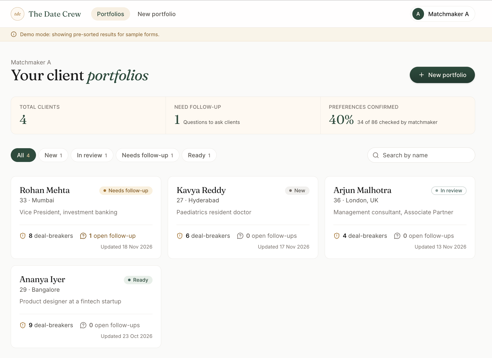
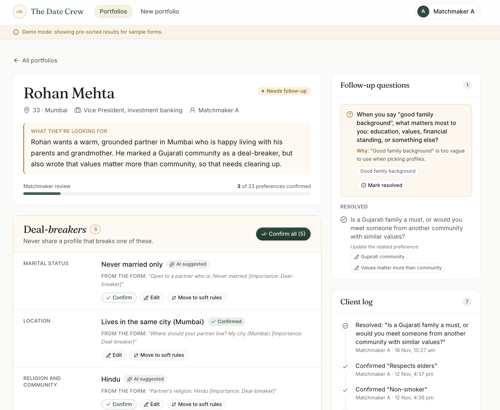
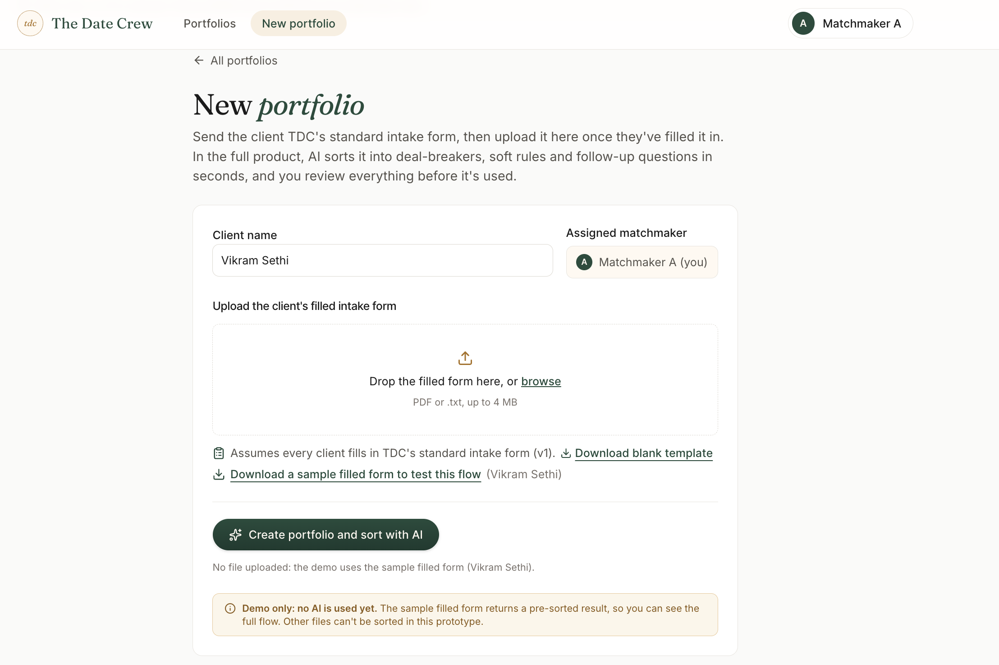

# TDC client portfolio

A prototype for **The Date Crew** Product Growth assessment: a client portfolio dashboard for matchmakers. One filled intake form becomes a structured, standard portfolio in seconds, and the matchmaker stays in control.

**Live demo:** https://tdc-product-assessment.vercel.app (demo data only; changes are saved in your browser, and "Reset demo data" in the footer starts fresh)

## The problem

In the last 30 days, TDC matchmakers shared **1,000** profiles and clients accepted **310 (31%)**. About **35% of rejections** were for reasons the client had *already stated* in their preferences. Matchmaker A gets **44%** acceptance and Matchmaker B **21%**, with the same tools.

The diagnosis: **client preferences aren't recorded in a standard, structured way.** Each matchmaker keeps notes in their own format, so preferences get written differently, buried in emails, or missed when picking profiles.

## What the prototype shows

Every client gets a portfolio with preferences sorted into the same 12 categories, split into **deal-breakers** and **soft rules**.

1. The matchmaker downloads TDC's blank standard intake form from the app and sends it to the client, who fills it in. *(Sending and filling in happen outside the app.)*
2. The matchmaker creates a new portfolio and uploads the filled form (or, for reviewers, uses the sample filled form).
3. **AI sorts the form:** preferences in standard categories, typed by the client's own importance marks, plus follow-up questions where answers clash or are vague, and a short summary.
4. **The matchmaker reviews it:** confirm, edit, or move a preference between deal-breakers and soft rules, and resolve follow-ups. Every action goes into the **client log**, and the original form stays attached.

Status updates on its own: **New** → **In review** → **Needs follow-up** (while questions are open) → **Ready** (everything confirmed, no open questions).

**Client portfolios:** Matchmaker A's clients, with a status for each and how many deal-breakers and open follow-ups they have.



**A client's portfolio:** deal-breakers and soft rules in standard categories, each quoting the client's own words and importance mark, with follow-up questions and the client log alongside. Here, one follow-up is resolved and its related preferences are one click away.



**New portfolio:** download the blank standard form, then upload the client's filled form (or use the sample filled form).



## Try it in 2 minutes

Everything starts on **New portfolio**, which follows the real flow: send the client the standard form, then upload it once they've filled it in.

1. **Download the blank template:** in section 1, click **Download blank template** to get TDC's standard intake form (v1) as a PDF, the form every client fills in. (**Preview** shows the same questions on screen.)
2. **Use the sample filled form, or upload it:** in section 2, click **Use a sample filled form (Vikram Sethi)**. It loads as if you'd uploaded it, fills in the client name, and **Preview** shows his answers. You can also download that file and upload it yourself; the app recognises it either way.
3. **Create the portfolio:** click **Create portfolio and sort with AI**. Vikram's portfolio opens with deal-breakers, soft rules and 4 follow-up questions:
   - three contradictions: Mumbai only vs moving abroad; age 25 to 28 vs 10+ years' experience; vegetarian vs sushi;
   - one importance clash: he marked non-smoking as only **Nice to have**, but wrote *"Absolutely no smokers"*. The AI keeps his mark (it stays a soft rule) and asks instead.
4. **Resolve a follow-up:** in the side panel, click **Mark resolved** on a question, add a note (e.g. *"A non-smoker is a must"*), then use **Update the related preference** to edit it or move it to deal-breakers. Every step appears in the **client log**.
5. **Confirm preferences until the status is Ready:** resolve the other follow-ups, then click **Confirm all** on each section (or confirm, edit and move them one by one). The status moves from *Needs follow-up* to *In review* to **Ready**.

**Test the "not the standard form" warning:** in section 2, click **Try a non-standard form** to download a free-form email from a client (Neha Iyengar), then upload it and create the portfolio. It opens with a warning that the file doesn't look like TDC's standard intake form, and sorts what it can.

Any other file shows a message that live AI sorting needs an API key, since this prototype runs on demo data only. The dashboard also has 4 mock clients to explore (try **Rohan Mehta**, who needs a follow-up). **Reset demo data** in the footer puts everything back.

## Assumptions

- **Every intake form is TDC's standard intake form, version `tdc-intake-v1`.** Every client answers the same questions, in the same order. The template lives in one place: [`lib/intake-form.ts`](lib/intake-form.ts).
  - **Why:** consistency between matchmakers. With one standard form, Matchmaker A and Matchmaker B always capture the same details, and every portfolio has the same shape. That directly targets the 35% of rejections for preferences the client had already given.
  - Sections 1 to 12 map one-to-one to the 12 preference categories (age and height, marital status, location, religion and community, language, education, profession and income, family, lifestyle, children, values and personality, other).
- **The client decides what's a deal-breaker, not the AI.** Every preference question has an importance mark chosen by the client:
  - Deal-breaker → deal-breaker
  - Nice to have → soft rule
  - Doesn't matter → not added
  - "Is there anything that's a definite no?" → deal-breakers. Other free text and "Anything to add?" notes → soft rules.
  - The AI never overrides the client's mark. When the wording disagrees with the mark, it raises a follow-up question instead.
- **If a file isn't the standard form**, the portfolio shows a warning ("This doesn't look like TDC's standard intake form. Results may be incomplete.") and sorts what it can. (Try it with the downloadable non-standard form on **New portfolio**.)
- **Only the matchmaker's side is built.** Sending the form to the client and the client filling it in happen outside the app.
- **One matchmaker's dashboard.** The app is Matchmaker A's view (set in [`lib/matchmakers.ts`](lib/matchmakers.ts)), standing in for a real login. Matchmaker B's clients exist in the data but aren't shown.

## What's mocked, and what would change in production

| Prototype | Production |
|---|---|
| **Demo data only.** The sample filled form and the non-standard form are recognised by a fingerprint of their content (SHA-256), however they're uploaded, and return pre-sorted results from [`data/sample-results`](data/sample-results); any other file shows a "live AI sorting needs an API key" message. | **Live AI sorting.** The server route [`app/api/sort-intake/route.ts`](app/api/sort-intake/route.ts) sends the form to Claude (API key kept on the server), with structured output checked against the same schema ([`lib/sort-schema.ts`](lib/sort-schema.ts)) and a retry if it doesn't match. |
| Data saved in the browser (`localStorage`, plus IndexedDB for files), through one module: [`lib/store.ts`](lib/store.ts). | A **Supabase** database and file storage. Only `lib/store.ts` and `lib/form-files.ts` would change; the screens stay the same. |
| No logins; the app is Matchmaker A's dashboard. | **Logins** for matchmakers, with each one seeing their own clients (and team leads seeing everyone). |
| The matchmaker uploads the filled form by hand. | **Email intake:** the standard form is sent to the client as a link, and answers arrive in the portfolio automatically. |
| The portfolio is reviewed, but nothing checks the profiles that get shared. | A **pre-send profile check:** before a profile is emailed, it's compared against the client's deal-breakers, and the matchmaker is warned about any clash. |
| 8 made-up clients, one sample filled form and one non-standard form. | Real client portfolios. |

## Run it locally

You need [Node.js](https://nodejs.org) 20 or newer.

```bash
npm install
npm run dev
```

Then open http://localhost:3000. **No environment variables or API keys are needed:** the prototype runs entirely on demo data.

## Demo data and scripts

All names and details are made up.

- [`data/intakes.ts`](data/intakes.ts): every client's filled standard form (8 mock clients and the sample client), plus the non-standard email, plus what the AI adds when sorting it (free-text preferences, summary, follow-ups).
- `npm run build:demo-data`: regenerates the form files in `public/mock-forms` and `public/sample-forms`, the demo results in `data/sample-results`, and the **blank template PDF** in `public/forms`, all from the template, so they always match it.
- `npm run check:data`: checks every source quote appears word for word in its form, and every demo result matches the expected format.

## Built with

Next.js (App Router, TypeScript), Tailwind CSS, shadcn/ui, zod, idb-keyval and pdf-lib (to draw the blank template PDF). Fonts: Fraunces and Inter. The look takes its feel from The Date Crew's site; the logo is a text-only stand-in.

*Prototype for The Date Crew Product Growth assessment · mock data only.*
